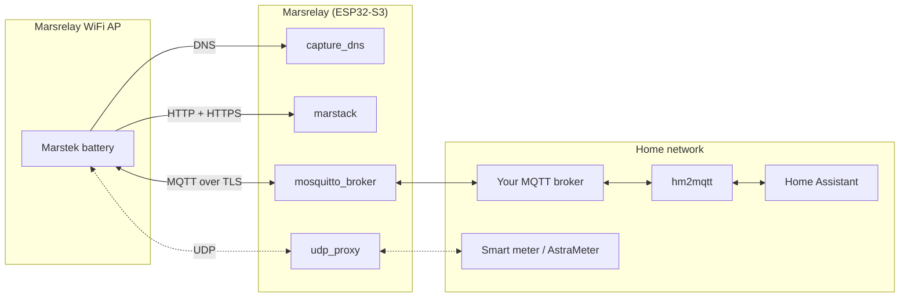

# Marsrelay

Marsrelay runs your Marstek Energy Storage system **without the Marstek cloud**: a small ESP32-S3 device emulates the cloud locally, so the battery never talks to Marstek while all data and controls flow into your home automation via MQTT.

- **No cloud** — all data stays in your home network. Without internet, Marsrelay needs a local time source to keep the batteries' schedules right ([details](docs/troubleshooting.md#can-marsrelay-run-without-internet))
- **No device hacking** — you only point the battery's WiFi at Marsrelay's access point
- **Home Assistant integration** via [hm2mqtt](https://github.com/tomquist/hm2mqtt)

<!-- marstek-family:start -->
**🔋 The Marstek ecosystem.** This repo is part of a family of open-source tools for Marstek batteries (B2500, Venus, Jupiter, …):

| Project | What it does |
|---|---|
| [hm2mqtt](https://github.com/tomquist/hm2mqtt) | Brings your battery into your smart home, turning its raw data into readable sensors and controls (e.g. in Home Assistant) |
| [hame-relay](https://github.com/tomquist/hame-relay) | Connects the official Marstek cloud/app and your local smart home so both work together, forwarding data whichever way your battery is set up |
| **marsrelay** (this repo) | Runs your battery completely offline, with no internet or Marstek cloud, while still sending all its data to your smart home |
| [AstraMeter](https://github.com/tomquist/astrameter) | Tells your battery your live grid usage (read from your existing meter) so it charges and discharges to avoid buying or selling power |
| [hmjs](https://github.com/tomquist/hmjs) | Sets up and configures B2500 batteries over Bluetooth, right from your web browser, with no app or account needed |
| [esphome-b2500](https://github.com/tomquist/esphome-b2500) | Continuously monitors and controls a B2500 over Bluetooth using a small ESP32 board |
<!-- marstek-family:end -->

## How It Works

Marstek batteries talk to two cloud services: an HTTP API and an MQTT broker. Marsrelay emulates both on one ESP32-S3:

1. **WiFi access point** (`wifi`): the battery connects to it, while Marsrelay stays connected to your home WiFi
2. **DNS capture** (`capture_dns`): every cloud hostname lookup is answered with Marsrelay's own IP
3. **Cloud HTTP emulation** (`marstack`): answers the Marstek cloud requests the battery makes, such as clock sync on port 80 and the TLS telemetry upload a Venus expects on port 443 (see [Cloud emulation](docs/cloud-emulation.md))
4. **Cloud MQTT emulation** (`mosquitto_broker`): a TLS broker on port 8883 accepts the battery's cloud MQTT connection — battery data (`.../device/...` topics) is forwarded to your home broker, commands (`.../App/.../ctrl`) are relayed back
5. **UDP proxy** (`udp_proxy`): bridges power meter broadcasts between both networks for zero feed-in

The battery thinks it's online; the Marstek app keeps working via Bluetooth only. You still need **hm2mqtt** on top — Marsrelay only moves raw MQTT messages, hm2mqtt parses them and creates the Home Assistant entities. **[Hame Relay](https://github.com/tomquist/hame-relay)** is *not* needed: it bridges the real cloud, which an offline setup doesn't have.

## Setup

You need: an ESP32-S3 board ([single](https://amzn.to/429OJDX) with "octal" PSRAM, [3-pack](https://amzn.to/3PwGRVv), [3-pack mini](https://amzn.to/4qIjp8P) with "quad" PSRAM), [ESPHome](https://esphome.io/) (e.g. the Home Assistant add-on), an MQTT broker, and [MQTT Explorer](https://github.com/thomasnordquist/MQTT-Explorer).

### 1. Flash Marsrelay

Download [`marsrelay_esp32s3.yaml`](marsrelay_esp32s3.yaml) and adjust the `substitutions:` block at the top:

- **`wifi_ssid` / `wifi_password`**: your home WiFi
- **`ap_ssid` / `ap_password`**: the WiFi network your battery will connect to
- **`mqtt_broker` / `mqtt_username` / `mqtt_password`**: your home MQTT broker
- **`timezone`**: used to keep the battery clock in sync ([timezone list](https://en.wikipedia.org/wiki/List_of_tz_database_time_zones))
- **`udp_proxy_port`**: depends on your power meter / firmware (see the comment in the file)
- **`psram`**: must match your board ([details](https://esphome.io/components/psram/))

Then build and flash it with ESPHome. In the ESPHome Device Builder, create a new device and replace its YAML with this file. That's the only file you need: the config pulls Marsrelay's components straight from this repository (`source: github://tomquist/marsrelay@main`), and each build picks up the latest version (ESPHome re-checks once a day).

If your config is from an older version and still has `type: local` / `path: ./components` under `external_components:`, replace that source with the GitHub one above rather than copying the `components` folder around.

### 2. Connect the battery

In the battery's WiFi settings, connect it to the Marsrelay access point (`ap_ssid` / `ap_password`). That's all the battery-side setup — no hacks, no firmware modification.

### 3. Find your device information

With Marsrelay up and running, power-cycle the battery once: it clears the battery's DNS cache, so the cloud hostnames are looked up again and now resolve to Marsrelay. A battery that joined the access point earlier can otherwise stay quiet for a long time.

Then, in MQTT Explorer (connected to your home broker), wait for a message on `marstek_energy/<deviceType>/device/<deviceId>/ctrl` — or `hame_energy/...` on older firmware. **Give this at least 30 minutes** from the power cycle — the first message usually arrives within 20, but longer is normal. Note down `deviceType` and `deviceId`.

- Ignore `.../App/...` topics — those are commands *sent by* hm2mqtt, not by your battery.
- On a Venus, the Marsrelay log also shows both as soon as the battery's MQTT connection is up: `Battery connected on 'marstek_energy/<deviceType>/App/<deviceId>/ctrl'`.
- Nothing appearing? See [troubleshooting](docs/troubleshooting.md#no-device-topic-ever-appears). You can also read the ID from Hame Relay's startup logs instead of waiting (see [finding the encrypted ID](docs/device-ids.md#finding-the-encrypted-id)).

### 4. Configure hm2mqtt

On current firmware the `deviceId` from step 3 is almost always a long **encrypted ID**, not the battery's MAC address. What goes into [hm2mqtt](https://github.com/tomquist/hm2mqtt) depends on the device family:

- **B2500/Saturn (HMA/HMB/HMF/HMK/HMJ types):** use the **Bluetooth MAC** as `deviceId` — never the encrypted ID — and add an `id_mappings` entry in Marsrelay. See [Device IDs](docs/device-ids.md).
- **Venus, Jupiter and everything else:** use the ID from step 3 as `deviceId`, exactly as it appears in the topic.
- If the topic shows a plain 12-digit MAC (older firmware, or a B2500 configured for local MQTT): just use that — done.

## Documentation

- [Device IDs](docs/device-ids.md): MAC address vs. encrypted ID, and how to map them for hm2mqtt
- [Cloud emulation](docs/cloud-emulation.md): which cloud requests Marsrelay answers, and its settings
- [Venus](docs/venus.md): the network dropouts every 15 minutes, local telemetry, AI mode, power class
- [B2500](docs/b2500.md): output power limits, charge level after a controller restart
- [A Marstek CT on its own Marsrelay](docs/marstek-ct.md)
- [Shelly UDP emulator](docs/shelly-emulator.md): serve a meter reading from ESPHome
- [EcoTracker](docs/ecotracker.md): use an everHome EcoTracker on your home network as the battery's meter
- [Diagnostics](docs/diagnostics.md): Home Assistant entities and automations for when data stops
- [Troubleshooting](docs/troubleshooting.md)

## Troubleshooting

The [diagnostic entities](docs/diagnostics.md) show which part stopped. See
[docs/troubleshooting.md](docs/troubleshooting.md) for:

- ["Platform not found" when validating the config](docs/troubleshooting.md#platform-not-found-or-component-not-found-when-validating-the-config)
- [The battery doesn't react to commands (e.g. cd=1)](docs/troubleshooting.md#the-battery-doesnt-react-to-commands-eg-cd1)
- [No /device/ topic ever appears](docs/troubleshooting.md#no-device-topic-ever-appears)
- [Repeating getDateInfoeu.php requests and UDP proxy log lines](docs/troubleshooting.md#repeating-getdateinfoeuphp-requests-and-udp-proxy-log-lines) (spoiler: that's normal)
- [A Venus keeps dropping off the network](docs/troubleshooting.md#a-venus-keeps-dropping-off-the-network)
- [Communication stops after a few hours / broker crashes](docs/troubleshooting.md#communication-stops-after-a-few-hours-or-the-log-shows-broker-crashes)
- [A B2500 stops answering about 30 minutes after a reset](docs/troubleshooting.md#a-b2500-stops-answering-about-30-minutes-after-a-reset)
- [The battery can't reach a power meter on my home network](docs/troubleshooting.md#the-battery-cant-reach-a-power-meter-on-my-home-network-eg-ecotracker)
- [hm2mqtt shows all entities as unavailable](docs/troubleshooting.md#hm2mqtt-shows-all-entities-as-unavailable)
- [Can Marsrelay run without internet?](docs/troubleshooting.md#can-marsrelay-run-without-internet)
- [Can I run Marsrelay on a Raspberry Pi?](docs/troubleshooting.md#can-i-run-marsrelay-on-a-raspberry-pi-instead-of-an-esp32)

## License

[MIT](LICENSE)
